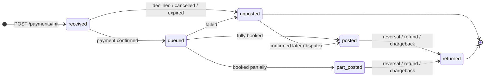

# GrossPay API — Bangladesh (BDT · bKash)

Merchant integration guide for accepting **bKash** deposits and sending **bKash** payouts in Bangladesh through the GrossPay API.

| | |
|---|---|
| **API version** | `v1` (document revision 2026-10-21) |
| **Country / currency** | Bangladesh · `BDT` |
| **Payment rail** | bKash personal wallet (`route_kind: "wallet"`) |
| **Pay-in (deposit)** | Hosted payment page only |
| **Pay-out (withdrawal)** | Server-to-server to a bKash wallet number |
| **Format** | JSON over HTTPS, Bearer-token auth, RSA-signed webhooks |

---

## Quickstart (5 steps)

1. **Get credentials** from your GrossPay manager: an **API key** (for requests) and your **webhook public key** (to verify callbacks). Separate pairs are issued for Test and Production.
2. **Allow-list the webhook sender IP** `136.148.218.118` on your `callback_uri`.
3. **Create a deposit:**

   ```bash
   curl -X POST https://api-test.grosspayme.com/v1/payments/init \
     -H "Authorization: Bearer $API_KEY" \
     -H "Content-Type: application/json" \
     -d '{
       "order_amount": "1000.00",
       "order_currency": "BDT",
       "intent": "debit",
       "route_kind": "wallet",
       "merchant_ref": "order_bd_0001",
       "holder_ref": "user_bd_001",
       "callback_uri": "https://your-site.com/webhooks/grosspay",
       "return_uri": "https://your-site.com/deposit/finished"
     }'
   ```

4. **Redirect the payer** to `hosted_url` from the response. The payer pays in the bKash app and enters the bKash TrxID on the page.
5. **Handle the webhook**: verify the `signature-v1` header, update your order from `posting_state` / `amount_posted`, reply `200`.

Then work through the [go-live checklist](docs/10-go-live-checklist.md).

---

## Documentation

| # | Section | What's inside |
|---|---|---|
| 01 | [Getting started](docs/01-getting-started.md) | Environments, merchant cabinet, authentication, conventions |
| 02 | [Pay-in (debit)](docs/02-pay-in.md) | Deposit flow, request fields, hosted page, examples |
| 03 | [Pay-out (credit)](docs/03-pay-out.md) | Withdrawal flow, bKash number rules, examples, safe retries |
| 04 | [Payment status](docs/04-payment-status.md) | `GET /state` by `payment_id` or `merchant_ref`, polling rules |
| 05 | [Webhooks](docs/05-webhooks.md) | Delivery, IP, signature verification, response codes, handler algorithm |
| 06 | [Payment object & lifecycle](docs/06-payment-object.md) | Every field, `posting_state` machine, how to book balances |
| 07 | [Errors](docs/07-errors.md) | Error envelope, `fault.class`, business codes `470–477`, retry policy |
| 08 | [Disputes](docs/08-disputes.md) | `POST /escalate` with receipts |
| 09 | [Balance](docs/09-balance.md) | `GET /partner/ledger_balance` |
| 10 | [Go-live checklist](docs/10-go-live-checklist.md) | Test scenarios and production readiness |

## Machine-readable spec & examples

| Path | Description |
|---|---|
| [`openapi/openapi.yaml`](openapi/openapi.yaml) | OpenAPI 3.0 specification (import into Swagger UI, Redoc, Postman, Insomnia, codegen) |
| [`postman/`](postman) | Postman collection + Test/Production environments |
| [`examples/curl/`](examples/curl) | Ready-to-run shell scripts for every endpoint |
| [`examples/webhooks/`](examples/webhooks) | Webhook receivers with signature verification: Node.js, Python, PHP |
| [`examples/python-client/`](examples/python-client) | Minimal Python client incl. bKash number normalisation |
| [`keys/`](keys) | Sandbox webhook public keys of the shared test merchant |

---

## Endpoints at a glance

Base URL — Production `https://api.grosspayme.com/v1`, Test `https://api-test.grosspayme.com/v1`.

| Method | Path | Purpose |
|---|---|---|
| `POST` | `/payments/init` | Create a payment: `intent: "debit"` (deposit) or `"credit"` (payout) |
| `GET` | `/payments/{payment_id \| merchant_ref}/state` | Get payment state |
| `GET` | `/partner/ledger_balance` | Get merchant balance |
| `POST` | `/payments/{payment_id}/escalate` | Open a dispute with attachments |
| `POST` | *your* `callback_uri` | Webhook on every state change (sent by GrossPay) |

## Payment lifecycle at a glance



Details: [Payment object & lifecycle](docs/06-payment-object.md).

## Support

- Merchant cabinet: [cabinet.grosspayme.com](https://cabinet.grosspayme.com) (Production), [test-cabinet.grosspayme.com](https://test-cabinet.grosspayme.com) (Test)
- Integration questions: your GrossPay account manager. When reporting an issue, always include `payment_id`, `merchant_ref`, environment and the UTC time of the request.

See [CHANGELOG.md](CHANGELOG.md) for document revisions.
