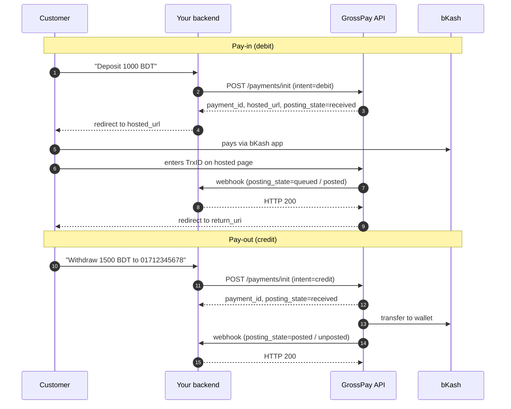

# 01 · Getting started

← [Back to README](../README.md) · Next: [Pay-in (debit)](02-pay-in.md) →

- [Environments](#environments)
- [Credentials you receive](#credentials-you-receive)
- [Authentication](#authentication)
- [Core concepts](#core-concepts)
- [Conventions](#conventions)
- [Integration flow overview](#integration-flow-overview)

---

## Environments

| Environment | API base URL | Merchant cabinet |
|---|---|---|
| **Test (stage)** | `https://api-test.grosspayme.com/v1` | `https://test-cabinet.grosspayme.com` |
| **Production** | `https://api.grosspayme.com/v1` | `https://cabinet.grosspayme.com` |

All paths in this documentation are relative to the base URL, e.g. `POST /payments/init` means
`POST https://api.grosspayme.com/v1/payments/init`.

Switching environments means switching **three** values together — never mix them:

| Value | Test | Production |
|---|---|---|
| Base URL | `api-test.grosspayme.com` | `api.grosspayme.com` |
| API key | test key | production key |
| Webhook public key | test public key | production public key |

> **Tip.** Keep all three in environment variables (`GROSSPAY_BASE_URL`, `GROSSPAY_API_KEY`, `GROSSPAY_WEBHOOK_PUBLIC_KEY`) so a deployment can never point at Production with Test credentials.

---

## Credentials you receive

| Credential | Used for | Where it lives |
|---|---|---|
| **API key** | Authenticating *your* requests to GrossPay | Server-side secret store only |
| **Webhook public key** (RSA, PEM) | Verifying that callbacks really come from GrossPay | Server config; it is public, not secret |

Each merchant has its own webhook public key; it is issued together with the API key. Public keys of the shared **sandbox test merchant** are in [`/keys`](../keys) — use them only with that sandbox account.

> **Security.** The API key grants full access to your merchant account (including payouts).
> Never put it in front-end code, mobile apps, Git repositories, tickets or chat messages. If a key leaks, ask your manager to rotate it immediately.

---

## Authentication

Every request must carry the API key as a Bearer token:

```http
Authorization: Bearer <API_KEY>
Content-Type: application/json
```

| Mistake | Result |
|---|---|
| Header present but **without** the `Bearer ` prefix | `403`, `fault.class: "unauthorized"` |
| Missing, wrong or revoked key | `401` / `403`, `fault.class: "unauthorized"` |

Example:

```bash
curl https://api-test.grosspayme.com/v1/partner/ledger_balance \
  -H "Authorization: Bearer $API_KEY"
```

---

## Core concepts

### Direction: `intent`

There is **one** endpoint to create payments — `POST /payments/init`. The direction is set by `intent`:

| `intent` | Meaning | Money flows | Payer interaction |
|---|---|---|---|
| `debit` | **Pay-in / deposit** | Customer → you | Customer pays on the hosted page |
| `credit` | **Pay-out / withdrawal** | You → customer | None, fully server-to-server |

### Rail: `route_kind` and currency

For Bangladesh always send:

```json
{ "order_currency": "BDT", "route_kind": "wallet" }
```

Do **not** send `route_network` for Bangladesh — the rail is bKash by default.

### Your identifiers

| Field | Who sets it | Purpose | Rules |
|---|---|---|---|
| `merchant_ref` | You | Your order / withdrawal ID. **Idempotency key.** Can be used instead of `payment_id` in `GET /state`. | 5–64 chars, unique per payment |
| `holder_ref` | You | Stable ID of the customer in your system | Up to 128 chars, same value for every payment of the same customer |
| `payment_id` | GrossPay | GrossPay payment ID (UUID) | Returned by `POST /payments/init` |

> Use one `holder_ref` per real customer (e.g. your internal user ID). GrossPay uses it for risk and limit checks — for example error `470` (*payer already has an active payment*) is evaluated per `holder_ref`.

### Hosted page vs. host-to-host

For Bangladesh **pay-ins work only through the hosted payment page** (`hosted_url`). Host-to-host mode (`silent_mode`) is **not available** — do not send it and do not try to render payment details yourself.

---

## Conventions

| Topic | Rule |
|---|---|
| Protocol | HTTPS only |
| Body format | JSON, UTF-8, `Content-Type: application/json` (except `/escalate`, which is `multipart/form-data`) |
| Amounts | **Strings** with two decimals: `"1000.00"`. Never send floats (`1000.0`) — parse amounts with a decimal type on your side, not `float`/`double`. |
| Currency | ISO 4217 code, always `"BDT"` for this geo |
| Timestamps | ISO 8601 in UTC with milliseconds: `"2026-10-21T05:36:26.058Z"` |
| `null` fields | Fields that are not yet known are present with value `null` (e.g. `posted_at` before posting). Do not treat a missing/`null` field as an error. |
| Unknown fields | New fields may be added at any time. Your parser must **ignore unknown fields** rather than fail. |
| Webhooks | Delivered from IP `136.148.218.118`, signed with RSA-SHA256 in header `signature-v1` |

---

## Integration flow overview



Next: [Pay-in (debit)](02-pay-in.md) →
