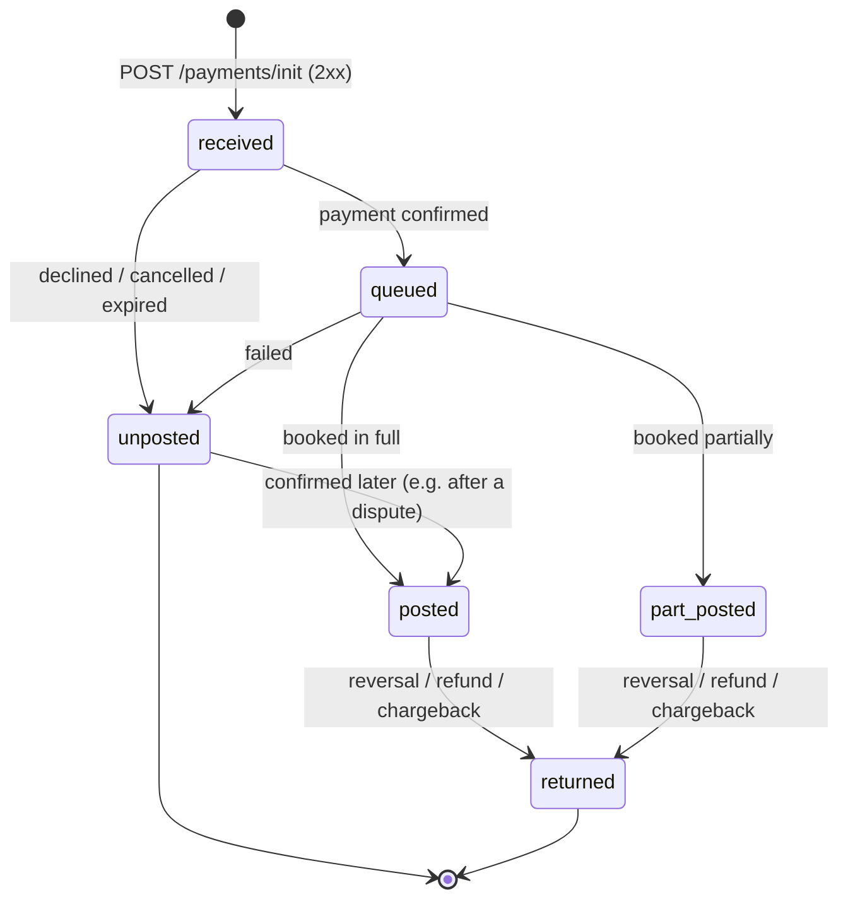

# 06 · Payment object & lifecycle

← [Webhooks](05-webhooks.md) · Next: [Errors](07-errors.md) →

The **payment object** is returned by `POST /payments/init`, by `GET /payments/{id}/state`, and is sent as the body of every webhook. One structure everywhere — parse it with one model.

- [Fields](#fields)
- [Amounts and fees](#amounts-and-fees)
- [`posting_state` values](#posting_state-values)
- [Lifecycle](#lifecycle)
- [How to book balances](#how-to-book-balances)
- [Examples by state](#examples-by-state)

---

## Fields

| Field | Type | Present | Description |
|---|---|---|---|
| `payment_id` | string (UUID) | always | GrossPay payment ID. Store it. |
| `merchant_ref` | string | always | Your ID from the request (idempotency key). |
| `hosted_url` | string \| null | pay-in only | Hosted payment page URL. Not present for payouts. |
| `posting_state` | string (enum) | always | Current state, see [below](#posting_state-values). |
| `route_kind` | string | always | Payment method from your request: `wallet`, `banglaqr`, `card`, `bank`. |
| `route_network` | string \| null | always (may be `null`) | Network or bank code from your request (`bkash`, `nagad`, …). `null` for `card`. For `wallet` requests sent without it — `bkash`. |
| `order_amount` | string (decimal) | always | Amount you requested. **Never changes.** |
| `order_currency` | string | always | `"BDT"` |
| `client_amount` | string (decimal) \| null | always (may be `null`) | **Amount on the customer's side**: pay-in — how much the customer actually paid; pay-out — how much the customer actually received. **Use it for the customer's (player's) balance.** `null` until the payment is booked. |
| `amount_posted` | string (decimal) | after booking | **Posting on your merchant balance at GrossPay** (before / including the fee): pay-in — the amount paid by the customer, the fee is then deducted from it; pay-out — the amount **debited from your merchant balance = payout + fee**. Use it to reconcile your merchant balance, **not** the player's balance. |
| `decline_note` | string \| null | always (may be `null`) | Human-readable reason when the payment is `unposted` / `returned`. For logs and support — **do not parse it**; it can change wording. |
| `booked_at` | string (ISO 8601, UTC) | always | When the payment was created. |
| `posted_at` | string (ISO 8601, UTC) \| null | always (may be `null`) | When the payment was booked; `null` before that. |
| `rail_ref` | string \| null | always (may be `null`) | Reference of the transfer in the wallet / bank system: wallet **TrxID** or bank reference. Appears once the transfer is known. Store it for reconciliation and disputes. |
| `holder_account` | string \| null | pay-in only (may be `null`) | Payer's wallet / account number — the one you sent in the request, or the one the customer actually paid from. **May be masked.** |
| `payee_details` | object \| null | always (may be `null`) | **Pay-outs:** the normalised recipient details (same keys as `credit_details`, e.g. `wallet_number` or `account_number` + `payee_title` + `routing_number`). `null` for pay-ins. |
| `valid_through` | string (ISO 8601, UTC) \| null | always (may be `null`) | Pay-ins: deadline for the payer to complete the payment. After it the payment ends as `unposted`. |

**Rules for your parser**

- All amounts are **strings**. Convert with a decimal type (`Decimal`, `BigDecimal`, `decimal.js`, `bcmath`) — never `float`.
- Treat any field as possibly `null`.
- Ignore unknown fields — new ones may be added without notice.
- Treat unknown `posting_state` values as *non-final, needs attention*: log them, don't crash, and don't credit.

---

## Amounts and fees

Two amounts, two different balances:

| Balance | Field | Pay-in (deposit) | Pay-out (withdrawal) |
|---|---|---|---|
| **Customer (player) balance** in your system | `client_amount` | **+** `client_amount` — what the customer paid | **−** `client_amount` — what the customer received |
| **Your merchant balance** at GrossPay | `amount_posted` and the fee | **+** `amount_posted` **−** fee | **−** `amount_posted` (payout + fee) |

GrossPay's fee is charged according to your tariff:

- **Pay-in:** the fee is **deducted from** the customer's payment. Your merchant balance grows by the payment minus the fee.
- **Pay-out:** the fee is **added on top** of the payout. Your merchant balance decreases by the payout plus the fee — so `available_balance` ([Balance](09-balance.md)) must cover the payouts **including fees**.

The fee itself is not part of the payment object; you see it per payment in the merchant cabinet and in the export.

### Example

Deposit of 20 000 BDT, payout of 15 000 BDT (fees are illustrative — yours depend on your tariff):

| | `order_amount` | `client_amount` | `amount_posted` | Fee | Player balance | Merchant balance at GrossPay |
|---|---|---|---|---|---|---|
| Deposit | 20000.00 | 20000.00 | 20000.00 | 1100.00 | **+20 000** | +20 000 − 1 100 = **+18 900** |
| Payout | 15000.00 | 15000.00 | 15450.00 | 450.00 | **−15 000** | **−15 450** |

> ⚠️ **Never debit the player by `amount_posted` on a payout.** For a 15 000 payout `amount_posted` is 15 450 — the extra 450 is GrossPay's fee charged to *your* merchant balance, not to the player.

**Merchant cabinet columns** — *Ordered* = `order_amount`, *Posted* = `amount_posted`, *Fee* = fee, *Net* = Posted − Fee. For a deposit *Net* is what was added to your merchant balance; for a payout *Net* equals the amount received by the customer, and your merchant balance was debited by *Posted*.

---

## `posting_state` values

| Value | Meaning | Final? | Pay-in (debit) action | Pay-out (credit) action |
|---|---|---|---|---|
| `received` | Payment created, waiting for payment | No | Show "pending" | Keep the amount reserved |
| `queued` | Payment confirmed, booking in progress | No | Show "processing" | Keep the amount reserved |
| `posted` | Fully booked | Yes¹ | Credit `client_amount` | Debit `client_amount` (normally = `order_amount`) |
| `part_posted` | Partially booked; actual amount in `client_amount` | Yes¹ | Credit `client_amount` | Debit `client_amount`, return the rest of the reserved amount |
| `unposted` | Not completed: declined, cancelled or expired | Yes² | Mark failed | Return the reserved amount |
| `returned` | Rolled back: reversal, refund or chargeback | Yes | Reverse the credit | Return the debited amount to the customer |

¹ `posted` and `part_posted` are final for the payment flow, but the money can still be **rolled back** later — the payment then moves to `returned`. Your system must allow this transition.

² An `unposted` payment can turn into `posted` / `part_posted` if the payment is confirmed later (e.g. after a [dispute](08-disputes.md)).

### Mapping to a simple status

If your platform uses a simple *pending / success / failed* status:

| `posting_state` | Simple status |
|---|---|
| `received`, `queued` | `pending` |
| `posted`, `part_posted` | `success` (for `part_posted`: success with a different amount) |
| `unposted` | `failed` |
| `returned` | `reversed` (treat as failed **and** undo any balance change) |

---

## Lifecycle



Notes:

- A payment does not have to pass through every state — e.g. you may receive `received` and then directly `posted`. Never require intermediate states.
- Webhooks can be delayed, duplicated, or arrive out of order. Decide by the state in the body, using the [handler algorithm](05-webhooks.md#handler-algorithm).
- An `unposted` payment can still become `posted` / `part_posted` if the payment is confirmed later — for example after a [dispute](08-disputes.md).
- `order_amount` is immutable; `client_amount` and `amount_posted` reflect what actually happened and may differ from `order_amount`.

---

## How to book balances

This section is about the **customer's (player's) balance** in your system, so it uses `client_amount`. The robust approach is to compute **what should be booked** for the current state and apply only the difference from what you have already booked:

```text
target = (posting_state in ['posted','part_posted']) ? client_amount : 0
delta  = target - already_booked_for_this_payment
if delta != 0: write ledger entry(delta); already_booked = target
```

Worked examples (pay-in, customer balance):

| Event sequence | Ledger entries | Customer balance change |
|---|---|---|
| `received` → `posted` (`client_amount` 1000.00) | +1000.00 | +1000.00 |
| `received` → `posted` (1000.00) → duplicate `posted` (1000.00) | +1000.00, *(duplicate → nothing)* | +1000.00 |
| `received` → `part_posted` (700.00) | +700.00 | +700.00 |
| `received` → `posted` (1000.00) → `returned` | +1000.00, −1000.00 | 0.00 |
| `received` → `unposted` | — | 0.00 |
| `posted` (1000.00) arrives **before** `queued` | +1000.00, *(late `queued` ignored as a step back)* | +1000.00 |

For payouts apply the same logic to the debit, with `client_amount` as the target:

| Event sequence (payout of 1000.00, fee 30.00) | Player balance |
|---|---|
| Request created — reserve 1000.00 | 1000.00 reserved |
| `posted` (`client_amount` 1000.00, `amount_posted` 1030.00) | −1000.00 (reserve becomes the final debit) |
| `part_posted` (`client_amount` 600.00) | −600.00, 400.00 returned to the player |
| `unposted` | 0.00, 1000.00 returned |
| `posted` → `returned` | 1000.00 returned to the player |

`amount_posted` (1030.00) is not used here — it is the debit of your merchant balance.

> **`returned` can make a customer balance negative** if they already spent or withdrew the deposit. Decide in advance how your platform handles this (block withdrawals, allow negative balance, manual review).

---

## Examples by state

### `received` — deposit created

```json
{
  "payment_id": "01a15cf5-f7c2-78b1-9276-87ea2c018577",
  "hosted_url": "https://pay.example/cmvhoj1x300001bo7cdylcnm8",
  "merchant_ref": "order_bd_0001",
  "posting_state": "received",
  "route_kind": "wallet",
  "route_network": "bkash",
  "rail_ref": null,
  "holder_account": null,
  "client_amount": null,
  "decline_note": null,
  "order_amount": "1000.00",
  "order_currency": "BDT",
  "booked_at": "2026-10-21T05:36:26.058Z",
  "posted_at": null,
  "payee_details": null,
  "valid_through": null
}
```

### `posted` — deposit booked

```json
{
  "payment_id": "01a15cf5-f7c2-78b1-9276-87ea2c018577",
  "hosted_url": "https://pay.example/cmvhoj1x300001bo7cdylcnm8",
  "merchant_ref": "order_bd_0001",
  "posting_state": "posted",
  "route_kind": "wallet",
  "route_network": "bkash",
  "client_amount": "1000.00",
  "amount_posted": "1000.00",
  "rail_ref": "9A1B2C3D4E",
  "holder_account": "017*****678",
  "decline_note": null,
  "order_amount": "1000.00",
  "order_currency": "BDT",
  "booked_at": "2026-10-21T05:36:26.058Z",
  "posted_at": "2026-10-21T05:41:02.511Z",
  "payee_details": null,
  "valid_through": null
}
```

### `part_posted` — payer paid less (illustrative)

```json
{
  "payment_id": "01a15cf5-f7c2-78b1-9276-87ea2c018577",
  "merchant_ref": "order_bd_0001",
  "posting_state": "part_posted",
  "client_amount": "700.00",
  "amount_posted": "700.00",
  "order_amount": "1000.00",
  "order_currency": "BDT",
  "booked_at": "2026-10-21T05:36:26.058Z",
  "posted_at": "2026-10-21T05:41:02.511Z"
}
```

Credit the player **700.00** (`client_amount`), not 1000.00.

### `unposted` — not completed (illustrative)

```json
{
  "payment_id": "01a15cf5-f7c2-78b1-9276-87ea2c018577",
  "merchant_ref": "order_bd_0001",
  "posting_state": "unposted",
  "decline_note": "Payment expired",
  "order_amount": "1000.00",
  "order_currency": "BDT",
  "booked_at": "2026-10-21T05:36:26.058Z",
  "posted_at": null
}
```

### `returned` — previously booked money rolled back (illustrative)

```json
{
  "payment_id": "01a15cf5-f7c2-78b1-9276-87ea2c018577",
  "merchant_ref": "order_bd_0001",
  "posting_state": "returned",
  "order_amount": "1000.00",
  "order_currency": "BDT",
  "booked_at": "2026-10-21T05:36:26.058Z",
  "posted_at": "2026-10-21T05:41:02.511Z"
}
```

Reverse whatever you credited / debited for this payment.

### `posted` — wallet payout (illustrative)

Payout of 15 000 with a 450 fee: the customer received 15 000, your merchant balance was debited by 15 450.

```json
{
  "payment_id": "01a1b1cc-684c-741b-b37f-5b7cf1981c0c",
  "merchant_ref": "withdraw_bd_0002",
  "posting_state": "posted",
  "route_kind": "wallet",
  "route_network": "bkash",
  "order_amount": "15000.00",
  "client_amount": "15000.00",
  "amount_posted": "15450.00",
  "rail_ref": "BK7Q2M9X1C",
  "order_currency": "BDT",
  "booked_at": "2026-11-06T16:58:00.000Z",
  "posted_at": "2026-11-06T17:01:12.000Z",
  "payee_details": { "wallet_number": "01712345678" }
}
```

Debit the player **15 000.00** (`client_amount`). The 450 difference is the fee on your merchant balance.

### `posted` — bank payout (illustrative)

```json
{
  "payment_id": "01a15d02-3b9e-7c11-8a4f-5e2d9c1b7a60",
  "merchant_ref": "withdraw_bd_0003",
  "posting_state": "posted",
  "route_kind": "bank",
  "route_network": "<bank_code>",
  "client_amount": "25000.00",
  "amount_posted": "25250.00",
  "rail_ref": "NPSB2611041234567",
  "order_amount": "25000.00",
  "order_currency": "BDT",
  "booked_at": "2026-11-04T08:10:00.000Z",
  "posted_at": "2026-11-04T08:12:31.000Z",
  "payee_details": {
    "account_number": "1234567890123",
    "payee_title": "Rahim Uddin",
    "routing_number": "123456789"
  }
}
```

*Illustrative examples are shortened to the relevant fields; real payloads contain the full object.*

Next: [Errors](07-errors.md) →
