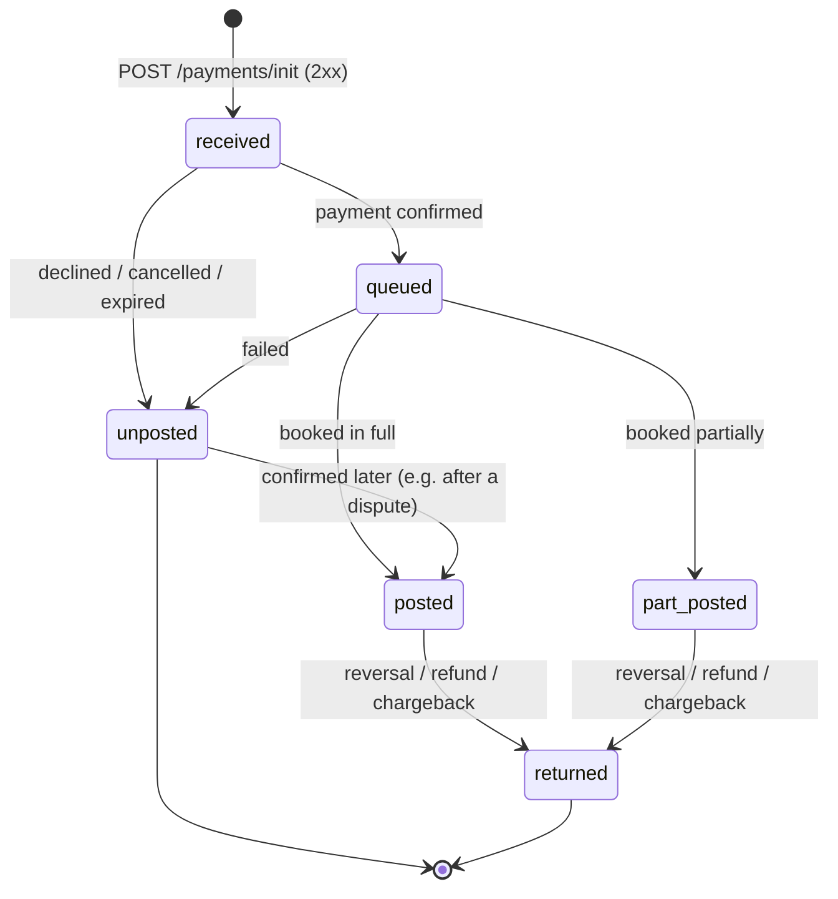

# 06 · Payment object & lifecycle

← [Webhooks](05-webhooks.md) · Next: [Errors](07-errors.md) →

The **payment object** is returned by `POST /payments/init`, by `GET /payments/{id}/state`, and is sent as the body of every webhook. One structure everywhere — parse it with one model.

- [Fields](#fields)
- [`posting_state` values](#posting_state-values)
- [Lifecycle](#lifecycle)
- [How to book balances](#how-to-book-balances)
- [Examples by state](#examples-by-state)

---

## Fields

| Field | Type | Present | Description |
|---|---|---|---|
| `payment_id` | string (UUID) | always | GrossPay payment ID. Store it. |
| `merchant_ref` | string | always | Your ID from the request (idempotency key). |
| `hosted_url` | string \| null | pay-in only | Hosted payment page URL. Not present for payouts. |
| `posting_state` | string (enum) | always | Current state, see [below](#posting_state-values). |
| `order_amount` | string (decimal) | always | Amount you requested. **Never changes.** |
| `order_currency` | string | always | `"BDT"` |
| `amount_posted` | string (decimal) | after booking | Amount **actually** booked. Appears once the payment is booked. The amount you credit/debit. |
| `client_amount` | string (decimal) \| null | always (may be `null`) | Settlement amount for the merchant; `null` until it is known. Use `amount_posted` for customer balances. |
| `decline_note` | string \| null | always (may be `null`) | Human-readable reason when the payment is `unposted` / `returned`. For logs and support — **do not parse it**; it can change wording. |
| `booked_at` | string (ISO 8601, UTC) | always | When the payment was created. |
| `posted_at` | string (ISO 8601, UTC) \| null | always (may be `null`) | When the payment was booked; `null` before that. |
| `payee_details` | object \| null | always (may be `null`) | Payment/recipient details, when applicable. `null` for hosted-page pay-ins. |
| `valid_through` | string (ISO 8601, UTC) \| null | always (may be `null`) | Deadline for the payer to complete the payment, when set. |

**Rules for your parser**

- All amounts are **strings**. Convert with a decimal type (`Decimal`, `BigDecimal`, `decimal.js`, `bcmath`) — never `float`.
- Treat any field as possibly `null`.
- Ignore unknown fields — new ones may be added without notice.
- Treat unknown `posting_state` values as *non-final, needs attention*: log them, don't crash, and don't credit.

---

## `posting_state` values

| Value | Meaning | Final? | Pay-in (debit) action | Pay-out (credit) action |
|---|---|---|---|---|
| `received` | Payment created, waiting for payment | No | Show "pending" | Keep hold |
| `queued` | Payment confirmed, booking in progress | No | Show "processing" | Keep hold |
| `posted` | Fully booked | Yes¹ | Credit `amount_posted` | Debit `amount_posted` |
| `part_posted` | Partially booked; actual amount in `amount_posted` | Yes¹ | Credit `amount_posted` | Debit `amount_posted`, release remainder |
| `unposted` | Not completed: declined, cancelled or expired | Yes² | Mark failed | Release hold |
| `returned` | Rolled back: reversal, refund or chargeback | Yes | Reverse the credit | Return money to customer |

¹ `posted` and `part_posted` are final for the payment flow, but the money can still be **rolled back** later — the payment then moves to `returned`. Your system must allow this transition.

² An `unposted` payment can turn into `posted` / `part_posted` if the payment is confirmed later (e.g. after a [dispute](08-disputes.md)).

### Mapping to a simple status

If your platform uses a simple *pending / success / failed* status:

| `posting_state` | Simple status |
|---|---|
| `received`, `queued` | `pending` |
| `posted`, `part_posted` | `success` (for `part_posted`: success with a different amount) |
| `unposted` | `failed` |
| `returned` | `reversed` (treat as failed **and** undo any balance change) |

---

## Lifecycle



Notes:

- A payment does not have to pass through every state — e.g. you may receive `received` and then directly `posted`. Never require intermediate states.
- Webhooks can be delayed, duplicated, or arrive out of order. Decide by the state in the body, using the [handler algorithm](05-webhooks.md#handler-algorithm).
- An `unposted` payment can still become `posted` / `part_posted` if the payment is confirmed later — for example after a [dispute](08-disputes.md).
- `order_amount` is immutable; `amount_posted` reflects reality and may differ from `order_amount`.

---

## How to book balances

The robust approach is to compute **what should be booked** for the current state and apply only the difference from what you have already booked:

```text
target = (posting_state in ['posted','part_posted']) ? amount_posted : 0
delta  = target - already_booked_for_this_payment
if delta != 0: write ledger entry(delta); already_booked = target
```

Worked examples (pay-in, customer balance):

| Event sequence | Ledger entries | Customer balance change |
|---|---|---|
| `received` → `posted` (`amount_posted` 1000.00) | +1000.00 | +1000.00 |
| `received` → `posted` (1000.00) → duplicate `posted` (1000.00) | +1000.00, *(duplicate → nothing)* | +1000.00 |
| `received` → `part_posted` (700.00) | +700.00 | +700.00 |
| `received` → `posted` (1000.00) → `returned` | +1000.00, −1000.00 | 0.00 |
| `received` → `unposted` | — | 0.00 |
| `posted` (1000.00) arrives **before** `queued` | +1000.00, *(late `queued` ignored as a step back)* | +1000.00 |

For payouts apply the same logic to the debit, with a hold created when the payout is requested.

> **`returned` can make a customer balance negative** if they already spent or withdrew the deposit. Decide in advance how your platform handles this (block withdrawals, allow negative balance, manual review).

---

## Examples by state

### `received` — deposit created

```json
{
  "payment_id": "01a15cf5-f7c2-78b1-9276-87ea2c018577",
  "hosted_url": "https://pay.example/cmvhoj1x300001bo7cdylcnm8",
  "merchant_ref": "order_bd_0001",
  "posting_state": "received",
  "client_amount": null,
  "decline_note": null,
  "order_amount": "1000.00",
  "order_currency": "BDT",
  "booked_at": "2026-10-21T05:36:26.058Z",
  "posted_at": null,
  "payee_details": null,
  "valid_through": null
}
```

### `posted` — deposit booked

```json
{
  "payment_id": "01a15cf5-f7c2-78b1-9276-87ea2c018577",
  "hosted_url": "https://pay.example/cmvhoj1x300001bo7cdylcnm8",
  "merchant_ref": "order_bd_0001",
  "posting_state": "posted",
  "amount_posted": "1000.00",
  "client_amount": null,
  "decline_note": null,
  "order_amount": "1000.00",
  "order_currency": "BDT",
  "booked_at": "2026-10-21T05:36:26.058Z",
  "posted_at": "2026-10-21T05:41:02.511Z",
  "payee_details": null,
  "valid_through": null
}
```

### `part_posted` — payer paid less (illustrative)

```json
{
  "payment_id": "01a15cf5-f7c2-78b1-9276-87ea2c018577",
  "merchant_ref": "order_bd_0001",
  "posting_state": "part_posted",
  "amount_posted": "700.00",
  "order_amount": "1000.00",
  "order_currency": "BDT",
  "booked_at": "2026-10-21T05:36:26.058Z",
  "posted_at": "2026-10-21T05:41:02.511Z"
}
```

Credit **700.00**, not 1000.00.

### `unposted` — not completed (illustrative)

```json
{
  "payment_id": "01a15cf5-f7c2-78b1-9276-87ea2c018577",
  "merchant_ref": "order_bd_0001",
  "posting_state": "unposted",
  "decline_note": "Payment expired",
  "order_amount": "1000.00",
  "order_currency": "BDT",
  "booked_at": "2026-10-21T05:36:26.058Z",
  "posted_at": null
}
```

### `returned` — previously booked money rolled back (illustrative)

```json
{
  "payment_id": "01a15cf5-f7c2-78b1-9276-87ea2c018577",
  "merchant_ref": "order_bd_0001",
  "posting_state": "returned",
  "order_amount": "1000.00",
  "order_currency": "BDT",
  "booked_at": "2026-10-21T05:36:26.058Z",
  "posted_at": "2026-10-21T05:41:02.511Z"
}
```

Reverse whatever you credited for this payment.

*Illustrative examples are shortened to the relevant fields; real payloads contain the full object.*

Next: [Errors](07-errors.md) →
